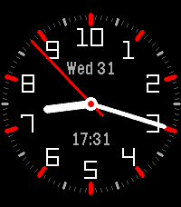
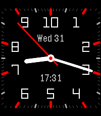

# DeciTime

This is a watch face designed for Pebble watches. It uses [decimal time](https://en.wikipedia.org/wiki/Decimal_time) and has a digital and analog watch face.

  

## Building & running

```sh
pebble build                          # build for all targetPlatforms
pebble install --emulator emery       # install on the emery emulator
pebble install --phone <ip>           # install to a paired phone
```

## Screenshots

`screenshots/<watch>/<face>-<font>.png` has every watch face (digital, analog
round, analog square) on every watch, in every font the watch offers. They
also supply the example pictures on the settings page (`src/pkjs/previews.js`).
To make them again after changing the face:

```sh
pebble build
python3 tools/screenshots.py          # all watches; or e.g. `emery gabbro`
pebble build                          # include the new pictures in the app
```

## Emulator troubleshooting

- **`pebble emu-app-config` fails with `TimeoutError`**: the watch face was
  not showing (installing can leave the emulator on the launcher, or a
  button was pressed). The emulator's phone only runs the face's JavaScript while the
  face is showing, and silently ignores the request otherwise. Go back to the
  face and try again:
  `pebble emu-button --emulator emery click back`
- **The settings page opens with the defaults** instead of your saved
  settings, and `pebble logs` shows `SyntaxError: unexpected data at the end`:
  the emulator was stopped (`pebble kill`) while the face was running, after
  settings were saved, and its copy of them is half-written. Save the
  settings again, then leave the face (open the launcher) before stopping the
  emulator.

## Target platforms

`targetPlatforms` in `package.json` controls which watches you build for. The
modern Pebble hardware is **emery** (Pebble Time 2), **gabbro** (Pebble Round
2), and **flint** (Pebble 2 Duo); the original Pebble platforms (aplite,
basalt, chalk, diorite) are included by default for backwards compatibility.

## Project layout

```text
src/c/           The watch face (C)
src/pkjs/        Phone side: the settings page (Clay) and sending settings
                 to the watch; previews.js is generated by tools/screenshots.py
screenshots/     Every face on every watch in every font (tools/screenshots.py)
tools/           Helper scripts
package.json     Project metadata (UUID, platforms, resources, message keys)
wscript          Build rules — usually no need to edit
```

## Documentation

Full SDK docs, tutorials, and API reference: <https://developer.repebble.com>

[//]: # (This file is part of pebble-deciteime, which is a Pebble watch face made by Ewout Klimbie)
