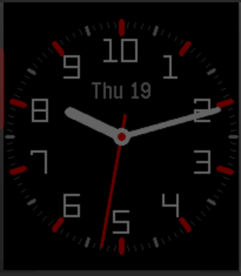

# DeciTime

This is a watch face designed for Pebble watches. It uses [decimal time](https://en.wikipedia.org/wiki/Decimal_time) and has a digital and analog watch face.



## Building & running

```sh
pebble build                          # build for all targetPlatforms
pebble install --emulator emery       # install on the emery emulator
pebble install --phone <ip>           # install to a paired phone
```

## Target platforms

`targetPlatforms` in `package.json` controls which watches you build for. The
modern Pebble hardware is **emery** (Pebble Time 2), **gabbro** (Pebble Round
2), and **flint** (Pebble 2 Duo); the original Pebble platforms (aplite,
basalt, chalk, diorite) are included by default for backwards compatibility.

## Project layout

```
.cursor/         Instructions for agentic AI.
src/c/           C source for the watchapp
src/pkjs/        PebbleKit JS (phone-side) source, if any
worker_src/c/    Background worker source, if any
resources/       Images, fonts, and other bundled resources
package.json     Project metadata (UUID, platforms, resources, message keys)
wscript          Build rules — usually no need to edit
```

## Documentation

Full SDK docs, tutorials, and API reference: <https://developer.repebble.com>

[//]: # (This file is part of pebble-deciteime, which is a Pebble watch face made by Ewout Klimbie)
