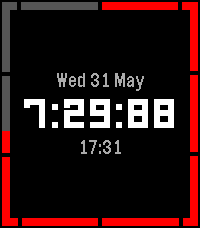

# DeciTime

This is a [decimal time](https://en.wikipedia.org/wiki/Decimal_time) watch face designed for Pebble watches.

  

Curious to see it on your watch? Get it from the [Pebble store](https://apps.repebble.com/decimal-time_5ac12856fb884322b0b0600e)!

## App store description

DeciTime tells the time the way the French Revolution tried to: 10 hours
a day, 100 minutes an hour, 100 seconds a minute. Midnight is 0:00, noon is
5:00.

Choose a ten-hour analog dial (round, or square on rectangular watches) or a
digital display that shows the day's progress around the edge of the screen.
Show the seconds, the normal time and the date always, never, or only when you
flick your wrist. On color watches, pick an accent color; on Pebble Time 2
and Round 2, pick a font as well. The date is shown in your watch's language.

Works on every Pebble, from the original to Pebble Time 2, Round 2 and
Pebble 2 Duo.

## Building & running

```sh
pebble build                          # build for all targetPlatforms
pebble install --emulator emery       # install on the emery emulator
pebble install --phone <ip>           # install to a paired phone
```

## Screenshots

`screenshots/<watch>/<face>-<font>.png` has every watch face (digital, analog
round, analog square) on every watch, in every font the watch offers. They
also supply the example pictures on the settings page (`src/pkjs/previews.js`).
To make them again after changing the face:

```sh
pebble build
python3 tools/screenshots.py          # all watches; or e.g. `emery gabbro`
pebble build                          # include the new pictures in the app
```

## Dial numerals

The analog dial places each numeral by its ink rather than its text box:
centered on the line from the center through its hour mark, the same distance
inside every mark on the round dial, and in a square ring of rows and columns
on the square dial. The ink positions come from the emulator; after changing a
dial font, the hour marks or that spacing, measure them again:

```sh
python3 tools/numeral_metrics.py      # rewrites the tables in src/c/decimal_time.c
pebble build
```

## Menu icon

The icon next to the face in the watch's list of watch faces is
`resources/images/menu_icon.png`: the top of the dial, 25 × 25 pixels, on a
black tile like the watch's own face icons (the app store shows the
screenshots instead). Edit it in any image editor and run `pebble build`.
Keep it to black and white, with transparency only in the rounded corners:
black-and-white watches get it as a 1-bit image, which turns transparent
pixels black, and the watch inverts it when its row is selected.

The 1-bit image is why `package.json` has two `MENU_ICON` entries. Only the
first has `"menuIcon": true`: the SDK refuses a second one, and uses that name
as the icon on every watch.

## Languages

The day and month names in the date follow the watch's language
(`setlocale(LC_TIME, "")` in `init()`); the firmware only translates them when
the app's locale is the system locale. The emulator has no language packs, so
it always shows English. The width of the date on the dial is measured on the
watch, so other languages keep it clear of the numerals.

## Emulator troubleshooting

- **`pebble emu-app-config` fails with `TimeoutError`**: the watch face was
  not showing (installing can leave the emulator on the launcher, or a
  button was pressed). The emulator's phone only runs the face's JavaScript while the
  face is showing, and silently ignores the request otherwise. Go back to the
  face and try again:
  `pebble emu-button --emulator emery click back`
- **The settings page opens with the defaults** instead of your saved
  settings, and `pebble logs` shows `SyntaxError: unexpected data at the end`:
  the emulator was stopped (`pebble kill`) while the face was running, after
  settings were saved, and its copy of them is half-written. Save the
  settings again, then leave the face (open the launcher) before stopping the
  emulator.

## Target platforms

`targetPlatforms` in `package.json` controls which watches you build for. The
modern Pebble hardware is **emery** (Pebble Time 2), **gabbro** (Pebble Round
2), and **flint** (Pebble 2 Duo); the original Pebble platforms (aplite,
basalt, chalk, diorite) are included by default for backward compatibility.

## Project layout

```text
src/c/           The watch face (C)
src/pkjs/        Phone side: the settings page (Clay) and sending settings
                 to the watch; previews.js is generated by tools/screenshots.py
resources/       The watch's menu icon
screenshots/     Every face on every watch in every font (tools/screenshots.py)
tools/           Helper scripts
package.json     Project metadata (UUID, platforms, resources, message keys)
wscript          Build rules — usually no need to edit
```

## Documentation

Full SDK docs, tutorials, and API reference: <https://developer.repebble.com>

[//]: # (This file is part of pebble-deciteime, which is a Pebble watch face made by Ewout Klimbie)
